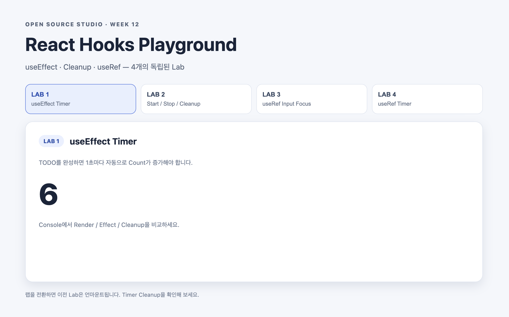
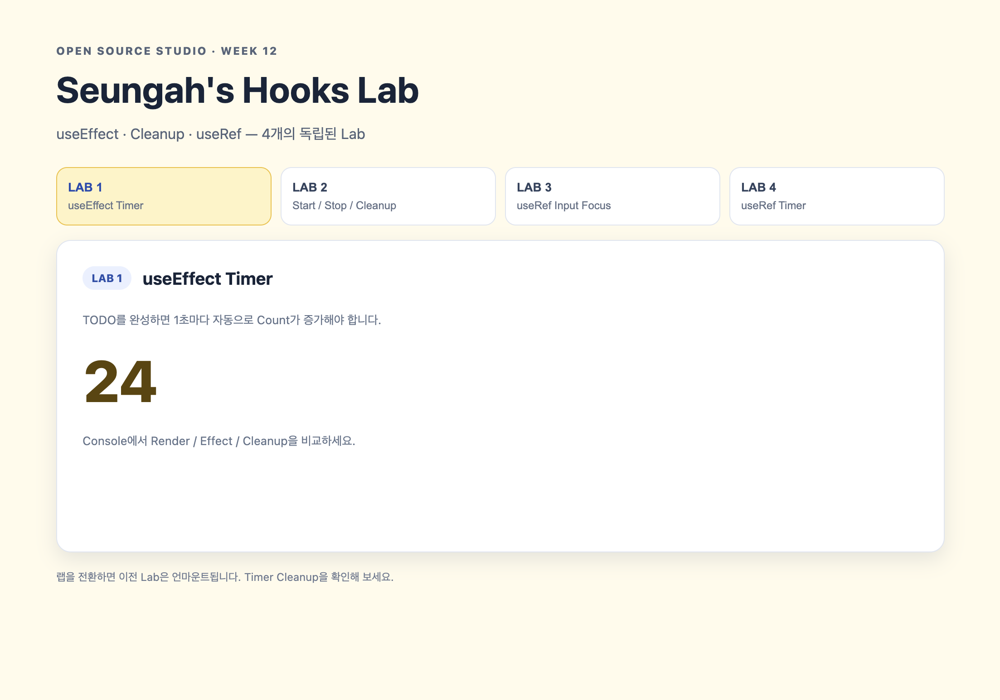
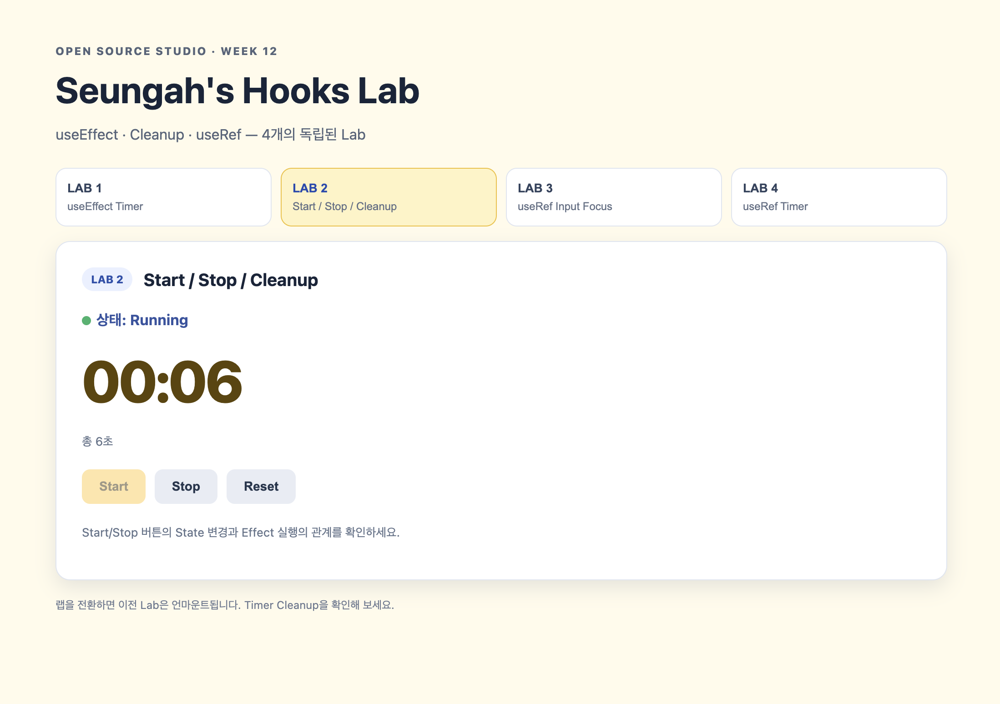
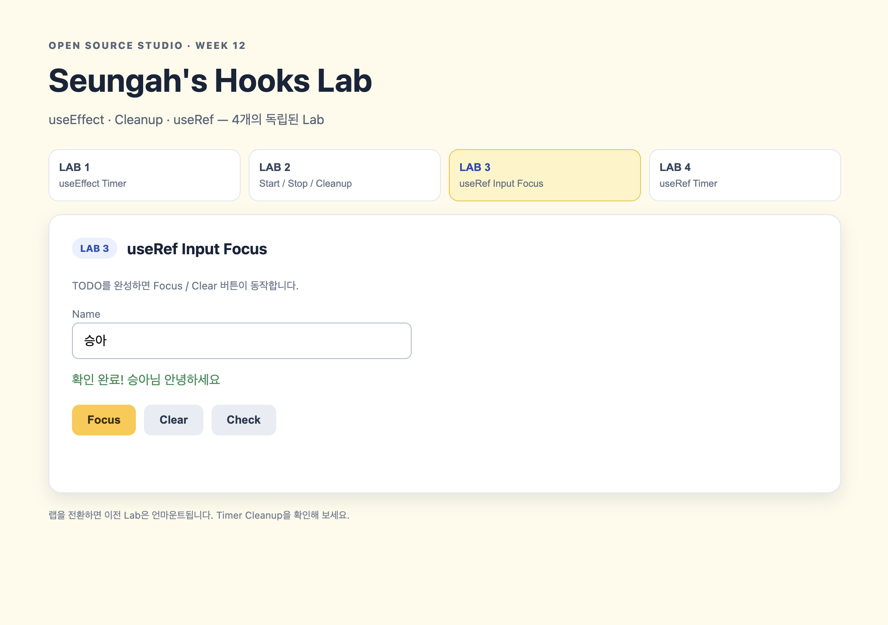
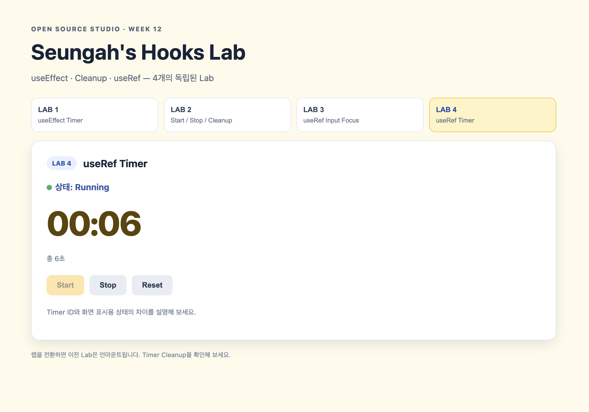

# Assignment 4-4. React Hooks Practice

## Project Information
- React의 useEffect와 useRef를 활용한 Timer 및 Input Focus 실습 프로젝트
- 주요 기능: 자동 Timer, Start/Stop Timer, Input Focus, useRef Timer 구현
- Starter Project: https://github.com/2026-2-OSS/week12_starter_project

## Installation
- 설치·실행 방법:
  npm install
  npm run dev
- 실행 화면
  

## Source Code Exploration
- 주요 파일 구조
  - App.jsx: Lab 컴포넌트 4개를 관리하고 선택한 Lab을 화면에 표시한다.
  - Lab1_EffectTimer.jsx: useEffect Timer 실습
  - Lab2_TimerControl.jsx: Timer Start, Stop 실습
  - Lab3_InputFocus.jsx: useRef Input Focus 실습
  - Lab4_RefTimer.jsx: useRef Timer 실습
- useEffect 및 useRef 분석
  - useEffect: 컴포넌트 렌더링 이후 실행되는 Hook으로 Timer 같은 작업을 처리할 때 사용한다. Dependency Array에 따라 실행하는 시점이 달라지고 Cleanup으로 이전 작업을 정리할 수 있다.
  - useRef: .current를 통해 값을 저장하고 접근할 수 있다. 값이 변경되어도 리렌더링되지 않고 DOM이나 Timer ID 등을 저장할 때 사용한다.
- 주요 코드 2개 설명
  1. useEffect Timer(lab1)
    ```jsx
    useEffect(() => {
      // TODO: Timer 시작
      // TODO: 1초마다 Count 증가
      // TODO: Cleanup에서 Timer 정리
      // TODO: Dependency Array 설정
    }, []);
    ```
  - useEffect를 사용해 타이머를 구현하도록 구성도어 있다.
  - Cleanup에서 Timer를 정리하도록 구성되어 있다.
  2. useRef Timer(lab4)
    ```jsx
    const timerRef = useRef(null);

    const start = () => {
      // TODO: Timer 시작
    };

    const stop = () => {
      // TODO: Timer 중지
    };
    ```
    - useRef를 이용해 Timer ID를 저장하고, Start와 Stop 함수에서 Timer를 제어하도록 구현하는 실습이다.

## Lab Implementation
- LAB 1 (`Lab1_EffectTimer.jsx`)
  - 1초마다 Count 증가, Cleanup
  

- LAB 2 (`Lab2_TimerControl.jsx`)
  - Start / Stop / Reset, running State
  
  
- LAB 3 (`Lab3_InputFocus.jsx`)
  - Input Focus / Clear, DOM Ref
  

- LAB 4 (`Lab4_RefTimer.jsx`)
  - Timer ID 관리, 중복 방지, Cleanup
  
  
## Lab Comparison
- useEffect의 Dependency Array가 필요한 이유는?
  - Effect의 실행 시점을 관리하고 불필요한 실행을 방지하기 위해 사용된다. `[]`를 지워보니 count가 바뀔 때마다 타이머가 지워지고 다시 만들어지는 걸 볼 수 있었다.

- Cleanup을 사용하지 않으면 어떤 문제가 발생할 수 있는가?
  - 컴포넌트가 사라져도 interval이 계속 돌아서 메모리 낭비가 생긴다. Start, Stop을 반복하면 이전 타이머가 안 지워지고 쌓여서 count가 1초에 여러 번 올라가거나 Stop을 눌러도 안 멈출 수 있다.

- useState와 useRef의 가장 중요한 차이는?
  - useState는 값이 변경되면 리렌더링되지만 useRef는 .current가 변경되어도 리렌더링되지 않는다.

- LAB 2와 LAB 4의 Timer 관리 방식은 어떻게 다른가?
  - LAB 2는 State 변경에 따라서 useEffect가 timer를 관리하고 LAB 4는 Ref에 Timer ID를 저장해서 이벤트 함수에서 직접 관리한다.

## Customizing
- `src/App.jsx`: 프로젝트 제목(`Seungah's Hooks Lab`) 변경
- `src/App.css`: 배경, 선택된 탭, 버튼 색상, Count 숫자 색상 등 커스텀 스타일 적용
- `src/formatTime.js`: 초를 mm:ss 형식으로 변환하는 함수 추가
- `src/components/Lab2_TimerControl.jsx`: 타이머 시간 표시 형식을 변경하고 상태 표시 추가
- `src/components/Lab3_InputFocus.jsx`: 입력값 검증 기능 추가
- `src/components/Lab4_RefTimer.jsx`: 타이머 시간 표시 형식을 변경하고 상태 표시 추가

## Deployment
- https://week12-starter-project-six.vercel.app/

## Weekly Review
- 새롭게 배운 내용 3가지:
  1. useEffect의 Dependency Array에 따라 Effect가 실행되는 시점이 달라지고, Cleanup은 다음 Effect 전이나 언마운트될 때 실행된다.
  2. setCount(count+1) 대신 setCount(prev => prev+1)을 써야 interval 안에서 오래된 값을 가져오는 문제가 생기지 않는다.
  3. useRef는 값이 바뀌어도 리렌더링이 안 돼서 화면에 안 보이지만 기억해야 하는 값을 저장할 때 쓴다.
- 어려웠던 점과 해결 방법
  - HTML과 비슷하면서도 다른 JSX 문법과 React의 코드 작성 방식이 헷갈렸던 것 같다. {}를 사용한 표현식이나 State에 따른 화면 렌더링 방식 등에 대해 코드를 작성하고 실행 결과를 확인하면서 차이를 이해했다.
- AI 활용 내용 및 느낀 점
  - 분/초 표시, 입력 검증, 상태 표시를 구현하는데 도움을 받았다. 위에 작성한 어려었던 점 등을 해결하기 위해 질문하며 이해하는데 도움을 받았다. AI가 제시한 코드를 그대로 사용하는게 아니라 각 코드가 왜 필요한지 등을 질문하고 직접 실행해 결과를 확인했다. AI를 활용하면 구현과 학습이 빨라지지만, 실제 실행을 통해 코드의 동작을 확인하는 과정은 또 다른 것이고 굉장히 중요한 부분이라는 것을 느꼈다.